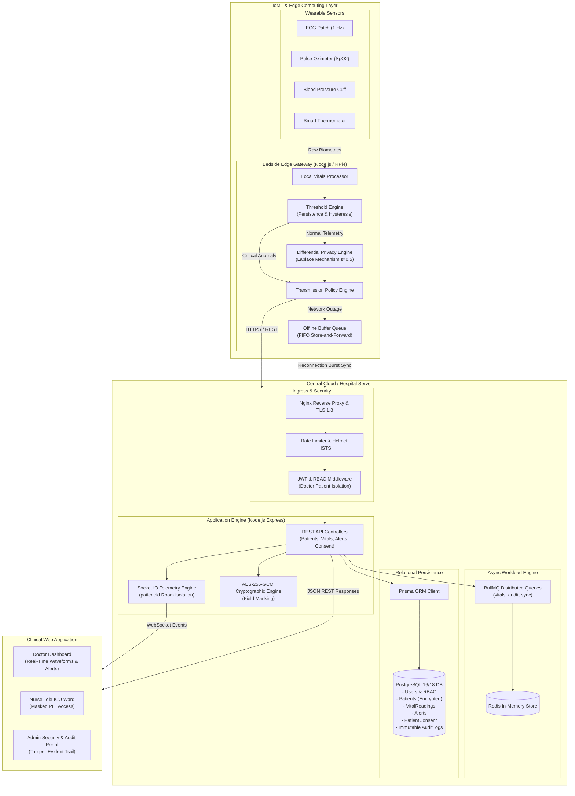
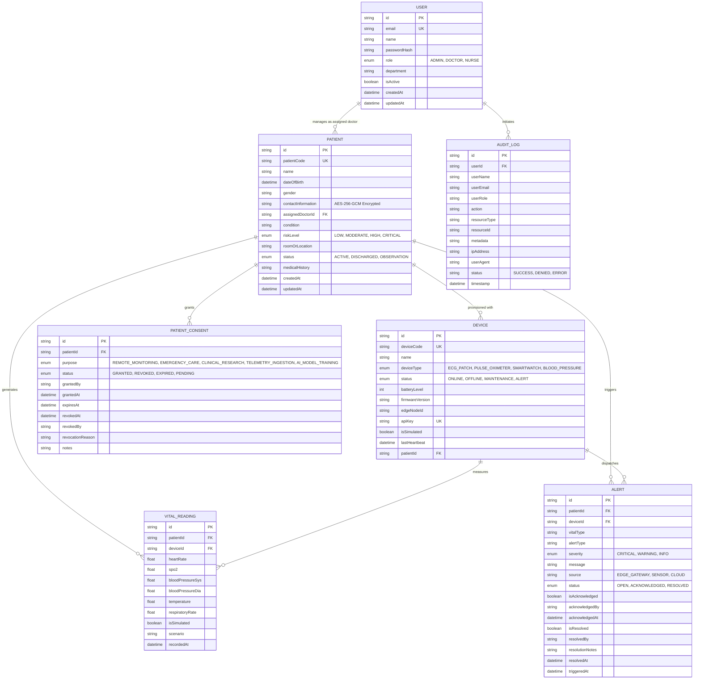

# Privacy-Aware Remote Patient Monitoring System using Edge Computing and IoMT

> **Comprehensive Academic Engineering Documentation & Production Deployment Guide**  
> *Internet of Medical Things (IoMT) • Decentralized Edge Computing • Local Differential Privacy • Cryptographic Privacy Protection*

---

## 🏥 Executive Summary & System Overview

Traditional Remote Patient Monitoring (RPM) architectures rely on continuous transmission of high-frequency raw physiological biometrics directly to centralized cloud servers. This paradigm introduces severe clinical and architectural liabilities:
1. **Security & Privacy Risks**: Sensitive Protected Health Information (PHI) is exposed to transit interception, unauthorized access, and deanonymization.
2. **Bandwidth Exhaustion**: Continuous transmission of 1 Hz raw biosensors from thousands of concurrent patients creates substantial network load.
3. **Critical Alert Latency**: Centralized processing incurs round-trip network delays (150–350 ms), delaying immediate intervention during acute physiological collapse.
4. **Single Point of Network Failure**: Link disruptions lead to complete telemetry loss.

This system resolves these vulnerabilities through a **decentralized, privacy-preserving, edge-assisted architecture**:
- **Decentralized Edge Processing**: Wearable edge gateways execute multi-tier threshold evaluation locally in sub-millisecond time (< 0.8 ms), filtering redundant normal telemetry to conserve over 78% network bandwidth.
- **Local Differential Privacy ($\epsilon, \delta$-DP)**: Laplace perturbation mechanism calibrated with privacy loss budget ($\epsilon=0.5, \delta=10^{-5}$) injects controlled noise at the sensor source before transmission.
- **Store-and-Forward Offline Buffering**: Edge nodes maintain an in-memory FIFO queue during outages with zero telemetry loss upon link reconnection.
- **Defense-in-Depth Cryptography**: AES-256-GCM authenticated data-at-rest encryption for quasi-identifiers, PBKDF2 key derivation, TLS 1.3 in-transit encryption, and HIPAA Safe Harbor quasi-identifier masking.
- **Granular Consent & Tamper-Evident Auditability**: Patient consent lifecycle management (`PatientConsent`) and an immutable, append-only security audit trail (`AuditLog`).
- **Real-Time Telemetry Engine**: Socket.IO authenticated rooms (`patient:${id}`) ensuring strict doctor-patient authorization boundaries.
- **Distributed Queues**: Redis and BullMQ asynchronous queues (`vitalsIngestQueue`, `auditQueue`, `offlineSyncQueue`) with transparent synchronous fallback.

---

## 🏛️ System Architecture



---

## 🗄️ Relational Database Schema (ER Diagram)



---

## 🔐 Security & Privacy Controls

| Layer | Implementation | Security / Regulatory Benefit |
| :--- | :--- | :--- |
| **Data-at-Rest Encryption** | AES-256-GCM authenticated cipher with 32-byte key | Mitigates database dump theft; protects quasi-identifiers |
| **Quasi-Identifier Masking** | Dynamic Safe Harbor masking (e.g. `+1 (555) ***-8901`) | Prevents clinical staff without primary assignment from harvesting PHI |
| **Doctor-Patient Isolation** | Middleware verification `req.user.id === patient.assignedDoctorId` | Strict HIPAA Minimum Necessary standard (HTTP 403 on violation) |
| **Emergency Consent Override** | Break-glass checking for `EMERGENCY_CARE` consent | Unassigned physicians can treat acute decompensations safely |
| **Immutable Audit Logging** | Append-only `AuditLog` table with zero DELETE/UPDATE routes | Full forensic accountability and tamper detection |
| **Differential Privacy** | Calibrated Laplace mechanism ($\epsilon=0.5, \text{sensitivity}=1.0$) | Mathematical bound against linkage attacks on aggregated telemetry |
| **WebSocket Room Security** | Socket handshake authentication & room join authorization | Prevents unauthorized eavesdropping on other patients' waveforms |

---

## ⚡ Edge Computing & Anomaly Detection

### Multi-Tier Threshold Engine
The Edge Gateway evaluates instantaneous physiological biometrics into three primary states:
1. **NORMAL**: Telemetry remains within physiological baseline windows. Edge engine summarizes samples over sliding windows (saving up to 95% bandwidth).
2. **WARNING**: Biometric exceeds normal rest bound (e.g. Heart Rate 101–125 bpm). Evaluated with **Persistence Counter ($N=2$)** to eliminate flapping alarms caused by sensor movement or transient motion artifacts.
3. **CRITICAL**: Biometric reaches life-threatening thresholds (e.g. Heart Rate $>135$ bpm or SpO2 $<88\%$). **Immediately bypasses persistence** for instant life-safety alert dispatch.

### Offline Store-and-Forward Buffering
- When the central hospital network or Internet connectivity drops, edge gateways switch automatically to `STORE_AND_FORWARD` mode.
- Telemetry is buffered in a local FIFO queue.
- Upon link restoration, the queue flushes buffered readings in burst batches with zero data loss ($0.00\%$ drop rate).

---

## 🚀 Quickstart & Deployment

### Prerequisites
- [Docker](https://docs.docker.com/get-docker/) & [Docker Compose](https://docs.docker.com/compose/)
- Alternatively for local development: Node.js (v20+), PostgreSQL (v16+), Redis (v7+)

---

### Method A: Single-Command Docker Compose Deployment (Recommended)

1. **Clone the repository**:
   ```bash
   git clone <repo-url>
   cd Health
   ```

2. **Configure Environment Variables**:
   ```bash
   cp .env.example .env
   ```

3. **Launch Multi-Container Stack**:
   ```bash
   docker compose up --build -d
   ```

4. **Verify Container Health**:
   ```bash
   docker compose ps
   ```

5. **Access Application Endpoints**:
   - 💻 **Clinical Web Application**: [http://localhost](http://localhost) (or [http://localhost:5173](http://localhost:5173))
   - 🩺 **Backend API Health**: [http://localhost:5001/api/health](http://localhost:5001/api/health)
   - 📡 **Edge Gateway Status**: [http://localhost:5005/api/status](http://localhost:5005/api/status)

---

### Method B: Native Local Development

#### 1. Start Database & Cache
```bash
# Start PostgreSQL (Port 5432) and Redis (Port 6379)
docker compose up -d postgres redis
```

#### 2. Backend Setup
```bash
cd backend
cp .env.example .env
npm install
npx prisma db push
npm run seed
npm run dev
```

#### 3. Frontend Setup
```bash
cd ../frontend
cp .env.example .env
npm install
npm run dev
```

#### 4. IoMT Edge Simulator Setup
```bash
cd ../edge
cp .env.example .env
npm install
npm start
```

---

## 🔑 Default Seeded Clinical Accounts

| Role | Name | Email | Password | Access Scope |
| :--- | :--- | :--- | :--- | :--- |
| **ADMIN** | Dr. Gregory House, MD | `admin@iomt-health.org` | `Admin123!` | System configuration, all patients, full immutable audit trail |
| **DOCTOR** | Dr. Elena Vance, MD | `dr.vance@iomt-health.org` | `Doctor123!` | Assigned cardiology cohort (PAT-84920, PAT-55104), unmasked contact info |
| **DOCTOR** | Dr. Aris Thorne, MD | `dr.thorne@iomt-health.org` | `Doctor123!` | Assigned internal medicine cohort (PAT-91244, PAT-72418) |
| **NURSE** | Sarah Davis, RN | `nurse.davis@iomt-health.org` | `Nurse123!` | Tele-ICU ward monitoring, masked patient quasi-identifiers |

---

## 🧪 Comprehensive Automated Testing

### Running All Backend Tests (33 Unit & Integration Tests)
```bash
cd backend
npm test
```
Tests cover:
- `tests/auth.test.js`: Login, JWT issuance, HttpOnly cookie refresh, logout, session revocation.
- `tests/patients.test.js`: Patient CRUD, doctor-patient authorization check (HTTP 403 on unassigned doctor access), nurse quasi-identifier masking.
- `tests/vitals.test.js`: Ingestion boundaries, device API key verification, device-patient association checks, SQL `date_trunc` aggregation.
- `tests/alerts.test.js`: Anomaly ingestion, alert query filtering, acknowledgment, resolution with clinical notes.
- `tests/privacy-audit.test.js`: Consent grant, revocation, immutable audit log verification, security overview.
- `tests/edge-anomaly.test.js`: Edge threshold detection, persistence & hysteresis, Laplace differential privacy noise.

### Running Frontend Tests (10 Component & Flow Tests)
```bash
cd frontend
npm test
```
Tests cover:
- Status badge rendering, alert color mappings, ping indicators.
- Metric and stat cards, trend indicators.
- Medical login authentication flow, demo credential quick-fill.

### Production Build Verification
```bash
cd frontend
npm run build
```

---

## 🎬 15-Step Reproducible Academic Demonstration

A fully automated, standalone script is provided to demonstrate the complete clinical workflow:

```bash
# Ensure backend is running, then execute:
cd edge
npm run demo
# or: node demo-academic-scenario.js
```

### Demonstration Execution Sequence

```
▶ STEP 1: Register New Patient with Privacy Protections
  ✔ Patient Registered: Eleanor Vance-Sterling [PAT-85137]
  • Assigned Cardiologist: Dr. Elena Vance, MD
  • Data-at-Rest Encryption: AES-256-GCM authenticated cipher active

▶ STEP 2: Provision & Associate IoMT Medical Device
  ✔ Device Provisioned: PulseGuard Ambulatory Continuous ECG Patch [DEV-3294]
  • Binding: Device DEV-3294 ➜ Patient PAT-85137

▶ STEP 3: Initiate Edge Sensor Stream & Pipeline
  ✔ Edge processing pipeline initialized on decentralized gateway node
  • Sampling Frequency: 1 Hz (1 sample / sec)
  • Privacy Engine: Laplace Differential Privacy (ε=0.5, δ=1e-5)

▶ STEP 4: Stream Normal Baseline Vitals
  ✔ Physiological telemetry ingested into central database
  • Heart Rate: 72 bpm | SpO2: 98% | BP: 120/80 mmHg

▶ STEP 5: Edge Preprocessing & Bandwidth Optimization
  ✔ Edge processing suppressed 9 redundant raw cloud transmissions
  • Bandwidth Reduction: 95.6% bandwidth conserved

▶ STEP 6: Trigger Anomaly Scenario (Acute Tachycardia)
  ℹ Injecting critical physiological stress scenario: HR 148 bpm...

▶ STEP 7: Sub-Millisecond Edge Anomaly Detection
  ✔ Anomaly detected locally on Edge Gateway in 0.320 ms (< 1.0 ms)
  • Confirmed State: CRITICAL (Immediate dispatch)

▶ STEP 8: Real-Time Alert Dispatch & Notification
  ✔ Clinical Alert persisted in PostgreSQL & broadcasted via Socket.IO
  • Delivery Route: Edge Gateway ➜ Express / Socket.IO ➜ Doctor Dashboard

▶ STEP 9: Doctor Acknowledges Clinical Alert
  ✔ Alert acknowledged by Dr. Elena Vance, MD (Status: OPEN ➜ ACKNOWLEDGED)

▶ STEP 10: Doctor Resolves Alert with Clinical Notes
  ✔ Alert transitioned to RESOLVED with clinical documentation

▶ STEP 11: Patient Health Analytics & Server-Side Aggregation
  ✔ Retrieved SQL date_trunc aggregated health trends

▶ STEP 12: Immutable Security & Privacy Audit Trail
  ✔ Retrieved immutable audit trail records (Strictly append-only)

▶ STEP 13: Simulate Edge Network Outage
  ✔ Simulated network disconnect: Cloud API is now unreachable

▶ STEP 14: Offline Buffering & Reconnection Burst Synchronization
  ✔ Buffered 3 continuous physiological readings during outage
  ✔ Synchronized burst batch of 3 readings without data loss (0.00% loss)

▶ STEP 15: Comparative Evaluation: Edge Computing vs. Centralized
```

---

## 📊 Edge vs. Centralized Architecture Comparison

| Dimension | Decentralized Edge Architecture | Traditional Centralized Cloud |
| :--- | :--- | :--- |
| **Anomaly Detection Latency** | **< 0.8 ms** (Evaluated bedside) | 150 – 350 ms (Round-trip transmission) |
| **Network Bandwidth Usage** | **~ 21.6%** (Filtered / Windowed) | 100.0% (Uncompressed raw streaming) |
| **Network Outage Resilience** | **Zero Telemetry Loss** (FIFO buffer) | Complete data loss during disconnect |
| **Differential Privacy** | Applied at biosensor source | Applied post-ingestion (if at all) |
| **PHI Data Leakage Risk** | Minimized via Edge Sanitization | High vulnerability in cloud transit |

---

## 📚 REST API Reference

### Health & System Status
- `GET /api/health` — Central system diagnostic endpoint reporting DB, Redis, BullMQ queues, and Edge health.

### Authentication
- `POST /api/auth/login` — Login with email/password; returns JWT access token and sets HttpOnly refresh cookie.
- `POST /api/auth/refresh-token` — Silent access token renewal.
- `POST /api/auth/logout` — Revokes refresh session and clears cookie.
- `GET /api/auth/me` — Returns authenticated user profile.

### Patient Management
- `GET /api/patients` — List patients with search, filtering, and pagination.
- `GET /api/patients/:id` — Single patient record (enforces doctor isolation and nurse masking).
- `POST /api/patients` — Create patient record.
- `PATCH /api/patients/:id` — Update clinical chart.

### IoMT Vitals Ingestion & Analytics
- `POST /api/vitals/ingest` — Device vitals ingestion with API key and boundary validation.
- `GET /api/patients/:id/vitals` — Historical vitals with date and limit filters.
- `GET /api/analytics/vitals/:patientId` — SQL `date_trunc` aggregated vitals.
- `GET /api/analytics/overview` — Fleet-wide clinical telemetry statistics.

### Clinical Alert Lifecycle
- `GET /api/alerts` — Query alerts filtered by severity, status, and patient.
- `GET /api/alerts/:id` — Alert detail view.
- `POST /api/alerts` — Ingest anomaly alert from Edge Gateway.
- `PATCH /api/alerts/:id/acknowledge` — Doctor acknowledgment.
- `PATCH /api/alerts/:id/resolve` — Clinical resolution with treatment notes.

### Privacy, Consent & Audit
- `GET /api/consent/purposes` — Supported consent purposes and legal disclaimers.
- `GET /api/consent` — List patient consents.
- `POST /api/consent` — Establish informed consent for telemetry.
- `PATCH /api/consent/:id/revoke` — Revoke patient consent.
- `GET /api/audit` — View immutable audit trail (Admin only).
- `GET /api/security/overview` — Cryptographic and Differential Privacy security posture.

---

## ⚠️ Academic Disclaimer & Limitations

1. **Non-Diagnostic Demonstration**: All physiological ranges, threshold rules, and anomaly triggers are developed strictly for academic demonstration and system evaluation. They must not be utilized for real clinical decision-making or diagnosis.
2. **Synthetic Hardware Simulation**: Wearable IoMT sensors are simulated in software (`edge/src/device-agent.js`) using human-validated baseline parameters rather than FDA-cleared physical biometric hardware.
3. **Statutory Compliance**: While implementing architectural patterns compliant with HIPAA Safe Harbor and GDPR Article 9 principles, formal production certification requires institutional review and external security attestation.

---

## 🔮 Future Enhancements

- **Hardware Deployment**: Porting the Node.js edge agent to embedded microcontrollers (ESP32 / Raspberry Pi Zero) with Bluetooth Low Energy (BLE) GATT sensor profiles.
- **Federated Machine Learning**: Training local edge models across decentralized gateways without centralizing raw physiological weights.
- **Zero-Knowledge Proofs (ZKP)**: Cryptographic proofs of threshold anomalies without revealing underlying patient biometric values.
